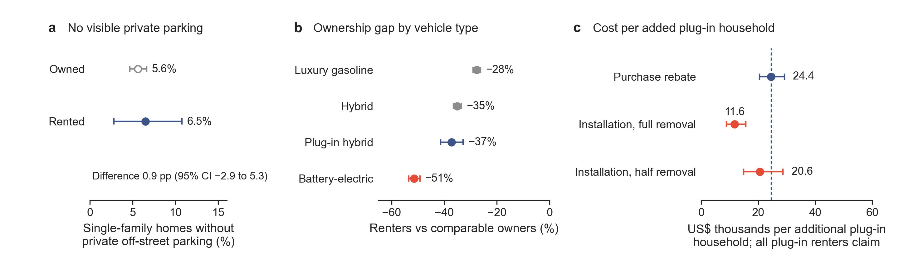
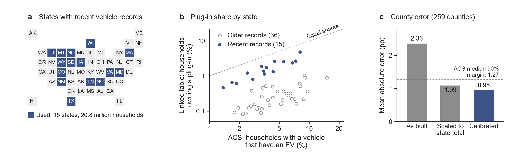
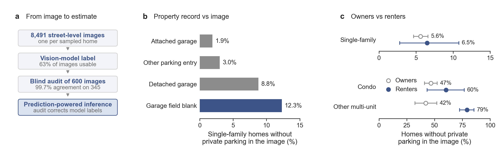
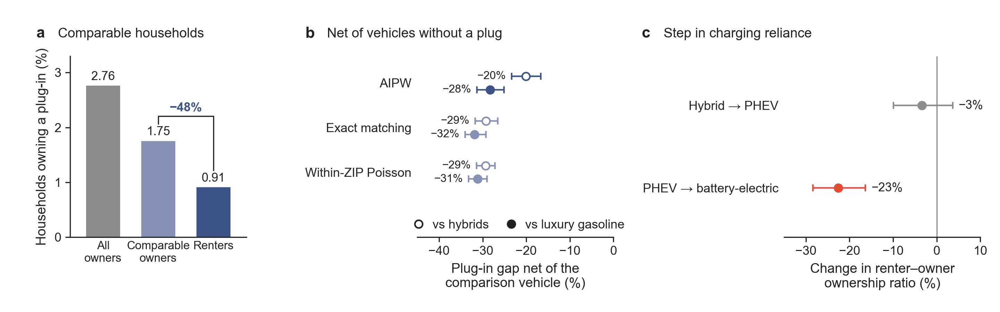
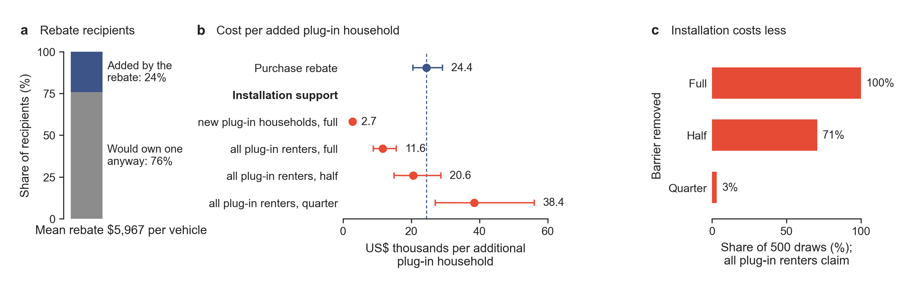
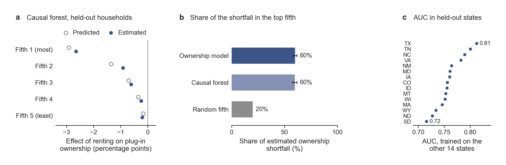

# Single-family renters are half as likely as comparable owners to own a plug-in vehicle, despite similar parking.

**Across 15 U.S. states, renters of single-family homes are 48% less likely than comparable owners to own a plug-in
vehicle. Street-level images show similar rates of visible off-street parking at rented and owned homes, while the
ownership gap grows with how much a vehicle relies on charging.**

Home charging needs two things: somewhere to park, and often a charger or new wiring that stays with the property. A
tenant may move before that investment pays off, while the landlord gains little from it; economists call this a
[split incentive](https://doi.org/10.5547/01956574.33.2.3). Street-level images measure parking. Charger installations and lease terms are not recorded, so the
investment explanation is tested through its predictions across vehicle types. The gap is about the same for hybrids
and plug-in hybrids, which can run on gasoline, and largest for battery-electric vehicles, which rely entirely on
charging.

In a simulation of 878,879 renter households, a purchase rebate large enough to offset the estimated barrier costs
$24,400 per additional household owning a plug-in, because most recipients would own one anyway. Installation support
costs $20,600 per additional household when every plug-in renter claims it and it removes half the barrier, and costs
less than the rebate in 71% of simulation draws. The comparison turns on how much of the barrier an installation
payment removes.

[Section 1](#measure) checks the household records against the census survey, and section 2 measures parking from
street images. [Section 3](#renters) compares renters with comparable owners, and [section 4](#simulation) simulates
two policies. Section 5 locates the estimated ownership shortfall, and section 6 relates the results to other studies.
The estimating equations, identifying assumptions, diagnostics and policy formulas are in the
[econometric methods](docs/methods.md).

**Scope.** Ownership is measured at one date in the 15 states with recent records, shown in Figure 2. The main
comparison covers single-family homes and adjusts for observed household, home and location characteristics. The
charging-related estimate also assumes that remaining differences affect plug-in ownership and the comparison vehicle
proportionally; section 3 examines sensitivity to these assumptions. Whether a charger was installed is not observed, so
split incentives are the interpretation, not a measured mechanism, and the images show parking that is visible from the
street. The repository reports aggregate results from licensed household-level records.



**Figure 1 | Similar parking access, a larger battery-electric ownership gap, and a conditional case for installation support.** **a**, Weighted share of single-family homes with no private off-street parking visible in a usable image, owned (open; 3,227 homes) and rented (filled; 175 homes), with 95% bootstrap intervals. **b**, Ownership by renters relative to comparable owners by vehicle type, from doubly robust (AIPW) estimates with 95% intervals; 878,879 renter households and a 12% sample of 13.8 million owner households. **c**, Mean spending per additional household owning a plug-in, with the central 95% range of 500 simulation draws, for a purchase rebate and for installation support when all plug-in renters claim it and it removes all or half of the barrier; the dashed line marks the rebate. See sections 2–4.

<a name="measure"></a>

## 1. Calibration reduces county mean absolute error from 2.36 to 0.95 percentage points.



**Figure 2 | Calibration lowered county mean absolute error from 2.36 to 0.95 percentage points.** **a**, The 15 states with recent vehicle records, 20.8 million households. **b**, Share of linked households owning a plug-in against the 2025 ACS share with an electric vehicle among households with a vehicle, by state, on log scales. Open points are states with older records and filled points the 15 states used; the correlation is 0.24 across all 51 jurisdictions and 0.90 across the 15. The dashed line marks equal shares. **c**, County mean absolute error across the 259 counties with an ACS benchmark, for the table as built, scaled to the state total, and calibrated; each state is predicted by a model fitted on the other 14. The dashed line marks the median ACS 90% margin of error.

Address linkage of licensed household-level records produced 53,069,701 households from 348,903,764 vehicle
registration rows ([table size](results/1_data/table_size.csv)). The county-by-tenure aggregation matched across DuckDB
and Spark SQL in all 94,110 cells ([engine comparison](results/1_data/sql_engine_agreement.csv)).

Only 15 states carry recent vehicle records. In those states the table's plug-in shares correlate with the census
survey at 0.90, against 0.24 across all states, and every analysis below uses only these 15
([state comparison](results/1_data/states_vs_acs.csv)).

In the linked records, 2.24% of all households own a plug-in. The ACS benchmark, 4.80%, uses households with a vehicle
as its denominator. Across the 259 counties with a published ACS estimate, mean absolute error was 2.36 percentage
points for the table as built, 1.09 after scaling to state totals and 0.95 after model calibration to those totals.
Each state was held out in turn. The median ACS 90% margin of error is 1.27 percentage points. The same procedure
provides estimates for 873 counties without a published ACS value
([county errors by method](results/1_data/county_error_by_method.csv)).

<sub><b>Methods.</b> DuckDB SQL over county Parquet files, with the same aggregation run in Spark SQL. A ridge model on the logit scale plus a state total, scored on 259 counties with whole states held out.</sub>

<a name="parking"></a>

## 2. Visible parking shortfalls are similar at rented and owned single-family homes.



**Figure 3 | Street images show similar private parking access at rented and owned single-family homes.** **a**, From 8,491 images to prediction-powered population shares; in the 600-image blind audit, the human and the model could both judge 345 images and agreed on private parking in 99.7% of them. **b**, Share of usable single-family images with no visible private off-street parking, by the garage category in the property record. **c**, Weighted shares without private parking for owners (open) and renters (filled), usable images, with 95% bootstrap intervals; single-family homes, the comparison used in section 3, are shown on their own scale above condos and other multi-unit homes.

The property record is a poor guide to parking. Among usable single-family images, 1.9% of homes recorded with an
attached garage and 12.3% of homes with a blank garage field show no private off-street parking. The record's garage
and parking fields alone predict the image's answer with an AUC of 0.69 for single-family homes, 0.68 for condos and
0.57 for other multi-unit homes ([garage categories](results/2_parking/parking_by_garage_record.csv),
[record against image](results/2_parking/record_vs_image_auc.csv)).

A vision model rated one street image for each of 8,491 sampled homes and could judge 63%. A second model agreed on
98.8% of jointly usable images ([Cohen's kappa](https://doi.org/10.1177/001316446002000104) 0.96) ([two models](results/2_parking/two_model_agreement.csv)). A human
reviewer independently labelled 600 randomly selected images without seeing the model's labels. Human and model agreed
on private parking for 99.7% of the 345 images both could judge ([audit table](results/2_parking/audit_vs_model.csv)).

[Prediction-powered inference](https://doi.org/10.1126/science.adi6000) used the audit to correct the model-based estimate. The estimated share without visible
private off-street parking was 11.5% overall (95% CI 9.5–13.7%), 7.6% in single-family homes, 52.6% in condos and 57.2%
in other multi-unit homes. The overall interval was 36% narrower than the audit-only interval
([population shares](results/2_parking/parking_shares.csv)).

In the separate tenure comparison, the weighted share without visible private off-street parking was 6.5% for rented
single-family homes and 5.6% for owned homes. The renter–owner difference was 0.9 percentage points (95% CI −2.9 to
5.3), with 175 usable rented homes. Even among single-family homes with visible private parking, renters had lower
adjusted odds of plug-in ownership (odds ratio 0.39, 95% CI 0.24–0.65). Together these findings weaken parking scarcity
as the primary explanation. In other multi-unit buildings, the no-parking shares were 79% for renters and 42% for
owners ([parking by tenure](results/2_parking/parking_by_tenure.csv),
[ownership odds](results/2_parking/ownership_odds_image_sample.csv)).

A [ConvNeXt](https://doi.org/10.1109/CVPR52688.2022.01167) model trained on the vision model's labels in 12 states scores an AUC of 0.946 against the hand labels on
105 images from three states it never saw, so new homes can be labelled without further calls to the vision model
([image model scores](results/2_parking/image_model_scores.csv)).

<sub><b>Methods.</b> A probability sample of 10,060 homes in 119 strata, with plug-in households over-sampled to 30% and inclusion weights kept; 84% have a street-level image. Two vision-language models with a fixed output schema. A blind 600-image hand audit. Prediction-powered inference with a bootstrap. ConvNeXt-Tiny fine-tuned in PyTorch on 12 states and tested on Colorado, Massachusetts and North Carolina. No images are stored in this repository.</sub>

<a name="renters"></a>

## 3. The renter gap persists after adjustment and is largest for battery-electric vehicles, as split incentives predict.



**Figure 4 | The renter gap persists after adjustment and is largest for battery-electric vehicles.** **a**, Share of households owning a plug-in among all owners of single-family homes, owners standardized to the characteristics of renters (the doubly robust counterfactual), and renters; the bracket gives the relative gap between renters and comparable owners. **b**, Renter-to-owner plug-in ownership ratio divided by the corresponding ratio for hybrids (open points) or recent luxury gasoline cars (filled points), minus one, for AIPW, exact matching on ZIP code, wealth decile, age band, household size and years at the address, and a Poisson regression with ZIP code fixed effects. **c**, Percentage change in the doubly robust renter-to-owner ownership ratio from hybrid to plug-in hybrid (PHEV) and from PHEV to battery-electric; zero means equal ratios, and the first interval includes zero. All intervals are 95%.

Split incentives predict an ownership gap among comparable households, a larger gap for plug-ins than for vehicles
that need no external charging, and the largest shortfall for battery-electric vehicles. Each panel tests one
prediction. The comparisons below assume overlap in household characteristics. Interpreting the gap net of a
comparison vehicle also requires remaining differences to affect the two ownership rates proportionally.

**Comparable households.** A plug-in is present in 0.91% of renter households and 2.76% of owner households, a raw
relative gap of 67%. The [doubly robust](https://doi.org/10.1080/01621459.1994.10476818) estimate puts ownership at 1.75% for comparable owners, leaving renters 48% less
likely to own a plug-in (ratio 0.52, 95% CI 0.50–0.54). The largest covariate imbalance after weighting is 0.04
standard deviations ([Figure A1](docs/methods.md#5-balance-and-overlap)). [Inverse-propensity weighting](https://doi.org/10.1111/1468-0262.00442) gives a ratio of 0.50. On a
percentage-point scale, the partially linear [DML](https://doi.org/10.1111/ectj.12097) estimate is −0.86 for renters relative to owners (95% CI −0.90 to
−0.82) ([ownership by estimator](results/3_renter_gap/ownership_renters_vs_owners.csv)).

**Beyond vehicles that need no charger.** Renters are also 35% less likely to own a hybrid and 28% less likely to own
a recent luxury gasoline car, so part of the plug-in gap may reflect who rents rather than charging. The renter-to-owner
ratio for plug-ins is 20% lower than the hybrid ratio (95% CI 17–23%) and 28% lower than the luxury-car ratio
(25–31%). Exact matching within ZIP codes gives 29% and 32%, and a [Poisson regression](https://doi.org/10.1162/rest.88.4.641) with ZIP code fixed effects gives
29% and 31% ([AIPW](results/3_renter_gap/net_gap_by_estimator.csv), [matching](results/3_renter_gap/exact_matching.csv),
[Poisson](results/3_renter_gap/poisson_by_household_type.csv)).

**Charging reliance.** A plug-in hybrid can also run on gasoline, while a battery-electric vehicle relies entirely on
external charging. Under AIPW, renter ownership was 35% lower for hybrids, 37% lower for plug-in hybrids and 51% lower
for battery-electric vehicles. The comparison between plug-in hybrids and hybrids was close to zero (−3%, 95% CI −10%
to 4%). Battery-electric vehicles showed a further 23% shortfall relative to plug-in hybrids (95% CI 16–28%). Exact
matching also gave a larger shortfall for battery-electric vehicles
([vehicle types](results/3_renter_gap/gap_by_vehicle_type.csv),
[matching by vehicle](results/3_renter_gap/exact_matching_by_vehicle.csv)).

The result survives the checks below; the details are in the [methods](docs/methods.md).

| Check | Result |
|---|---|
| Households with two or more vehicles, matched as above | Net gap 26% and 30%; battery-electric 28% below plug-in hybrid |
| Condo owners, who own but do not control the building | Net gap 23% against owners of houses in the same ZIP code |
| Households at the address for 15 years or more | The net gap is smaller: 9% to 10% under AIPW and 17% to 19% under Poisson. The pattern is consistent with some residential sorting. |
| Strength of an unobserved confounder needed to remove the estimate | An association of 1.8 to 2.1 with both renting and ownership ([E-value](https://doi.org/10.7326/M16-2607)) |
| Omitting controls for wealth and home value, location, or years at the address | Net gaps of 19% to 28% across specifications |
| Classifying households with unrecorded tenure as renters | Net gaps of 17% to 21% across comparison vehicles |

<sub><b>Methods.</b> The estimation sample includes 878,879 renter households and 1,660,856 owner households sampled from 13.8 million owners of single-family homes. Gradient-boosted propensity and outcome models use five-fold cross-fitting. AIPW estimates the ownership ratio for renters relative to comparable owners. Joint influence functions give intervals for ratios relative to hybrids and recent luxury gasoline cars. Figure 4 uses matching cells defined by ZIP code, wealth decile, age band, household size and years at the address; a finer sensitivity specification also uses construction era and education. Additional checks use DML, ZIP fixed-effect Poisson models, balance and overlap diagnostics (<a href="docs/methods.md#5-balance-and-overlap">Figure A1</a>), and sensitivity to unobserved differences. The <a href="#simulation">policy simulation</a> uses the two <a href="https://doi.org/10.1097/EDE.0b013e3181d61eeb">negative-control</a> comparisons.</sub>

<a name="simulation"></a>

## 4. Installation support can cost less per additional plug-in household than a purchase rebate.



**Figure 5 | When every plug-in renter claims it and it removes half the barrier, installation support costs less per additional plug-in household than the purchase rebate in 71% of draws.** The simulation covers 878,879 renter households and 500 draws. **a**, Recipients of a purchase rebate sized to offset the barrier, by whether they would own a plug-in without it; the amount below the panel is the mean rebate per vehicle. **b**, Mean spending per additional household owning a plug-in, with the central 95% range of draws, for the rebate and for installation support at permit-reported costs; rows vary who claims support and how much of the barrier it removes, and the dashed line marks the rebate. **c**, Share of draws in which installation support costs less per additional household than the rebate when every plug-in renter claims it.

**How many households could gain a plug-in?** About 8,000 of the 878,879 renter households own a plug-in. At the
ownership rate of comparable owners, about 15,400 would. Removing the part of the gap linked to charging would add
2,000–3,200 plug-in households, depending on whether hybrids or luxury gasoline cars are the comparison. The household
simulation averages 2,595 additional plug-in households under full barrier removal
([household counts](results/4_policy/barrier_size.csv), [simulation checks](results/4_policy/simulation_checks.csv)).

**The barrier in dollars.** It lowers ownership as much as a 9% to 17% higher price would, using two published price
elasticities of demand for electric vehicles: −2.76 from
[Xing, Leard, and Li (2021)](https://doi.org/10.1016/j.jeem.2021.102432) and −2.1 from
[Muehlegger and Rapson (2022)](https://doi.org/10.1016/j.jpubeco.2022.104752). At the median price of a plug-in owned in the 15 states
($48,490), that is $4,100 to $8,300 per vehicle, 55% to 111% of the former $7,500 federal tax credit
([price equivalents](results/4_policy/barrier_size.csv), [methods](docs/methods.md#10-the-gap-in-units-of-price)).

**Purchase rebate.** Matching the estimated ownership gain requires a rebate of $4,100–$8,300 per eligible vehicle.
About 76% of recipients would own a plug-in without it. Averaged across draws, the program spends $24,400 per
additional household owning a plug-in (95% simulation range $20,500–$29,200)
([policy costs](results/4_policy/policy_costs.csv)).

**Installation support.** Cambridge permits report a median declared value of $1,500 for charger-only work and $4,350
for work that includes a panel or service upgrade. The simulation draws from both groups. With full barrier removal,
mean spending per additional plug-in household is $2,700 when only new plug-in households claim support and $11,600
when all plug-in renters claim. Under the latter rule, removing half the barrier costs $20,600 per additional household
on average and costs less than the purchase rebate in 71% of draws. Removing a quarter costs $38,400 per additional
household and costs less than the rebate in 3% of draws ([permit values](results/4_policy/permit_costs.csv),
[policy costs by scenario](results/4_policy/policy_costs.csv)).

**What installation support can address.** The rebate implied by the ownership gap and published price elasticities is
several times the median declared value of a charger-only permit. The two figures come from different sources: one is
inferred from ownership, the other describes completed electrical work. A tenant may also need the landlord's
permission or expect to move before a charger pays off, and a payment for the work changes neither. The simulation
therefore varies how much of the barrier a payment removes. Both payments use public money, and a right to install
without a payment leaves the cost of the work with the tenant.

These calculations are a first, intuitive pass that expresses the estimates of section 3 in households and dollars and
compares the two policies. A structural model of vehicle choice and charger installation is being developed in a
companion paper, and this repository will be updated with it. The formulas and the full policy table are in the
[methods](docs/methods.md#12-policy-simulation).

<sub><b>Methods.</b> The barrier sized from the doubly robust estimates of section 3. A constant-elasticity price equivalent, (1 + t)<sup>e</sup> = r, with two published elasticities. Monte Carlo microsimulation over 878,879 households with 500 draws and common random numbers, checked against the closed form. Installation costs from public permit records queried through two cities' open-data APIs.</sub>

## 5. The highest-ranked fifth of renters accounts for 60% of the estimated ownership shortfall.



**Figure 6 | Both rankings place about 60% of the estimated ownership shortfall in the top fifth of renters.** **a**, Predicted (open) and doubly robust (filled) effects of renting in fifths of 600,000 held-out households sorted by the causal forest's prediction. **b**, Share of the estimated ownership shortfall in the top fifth of 300,000 scored renters, with 95% bootstrap intervals for the two model rankings; a random fifth holds 20% by construction. **c**, Ownership-model AUC in each state when the model is trained on the other 14; state totals require separate calibration.

A [causal forest](https://doi.org/10.1080/01621459.2017.1319839) trained on 250,000 households ranked a separate 600,000 households by their predicted ownership
difference. In the fifth with the largest predicted gap, plug-in ownership was 2.65 percentage points lower for renters
than for comparable owners, against a prediction of 2.92 points. In the fifth with the smallest, the estimated and
predicted differences were 0.20 and 0.16 points ([forest fifths](results/5_which_renters/forest_fifths.csv)).

Among 300,000 scored renters, the top fifth accounted for about 60% of the estimated ownership shortfall relative to
comparable owners (95% CI 58–62%) under either ranking: one model ranks renters by predicted ownership, the other by
the forest's predicted renter–owner difference. A random fifth accounts for 20%. This measures where the ownership
shortfall is concentrated. Closing it would require evidence on how households respond to a program
([shortfall by ranking](results/5_which_renters/shortfall_share_by_ranking.csv)).

The ownership model still ranked households well when each of the 15 states was held out in turn (AUC 0.72–0.81).
Predicted totals ranged from 0.73 times observed ownership in Colorado to 2.93 times in North Dakota, so local totals
need calibration to a benchmark, such as the state totals used in section 1
([state results](results/5_which_renters/auc_by_held_out_state.csv)). A separate exercise predicted whether a
household's newest vehicle, by model year, was a plug-in. Summary features from its older vehicles raised average
precision from 0.142 to 0.213, with little further gain from sequence models
([vehicle history models](results/5_which_renters/vehicle_history_models.csv)).

<sub><b>Methods.</b> A causal forest (<a href="https://github.com/py-why/EconML">CausalForestDML</a>) fitted on one random part of the sample and evaluated on a disjoint part, with doubly robust group estimates. <a href="https://doi.org/10.1214/aos/1013203451">Gradient boosting</a> on 20.8 million households with whole states held out; a <a href="https://doi.org/10.3115/v1/D14-1179">GRU</a> and a <a href="https://proceedings.neurips.cc/paper/2017/hash/3f5ee243547dee91fbd053c1c4a845aa-Abstract.html">Transformer</a> over each household's vehicles ordered by model year.</sub>

## 6. Related evidence.

The studies below provide outside comparisons for ownership differences and subsidy receipt, an
economic account of investment in rented housing, and the price elasticities used in the simulation. Their populations
and policy settings differ from the single-family renter households studied here. The full reference list, including the
methods used, is at the end of the [econometric methods](docs/methods.md#references).

- **The renter gap.** In national survey data, homeowners are about three times as likely as renters to own an
  electric vehicle, and the gap remains after controls ([Davis 2019](https://doi.org/10.1080/13504851.2018.1523611)).
  The raw ratio here is similar, 2.76% against 0.91%.
- **Split incentives.** When the party who pays for an energy investment in a dwelling is not the party who benefits,
  owners and occupants make different choices; in California data the energy savings from correcting this are small
  ([Gillingham, Harding, and Rapson 2012](https://doi.org/10.5547/01956574.33.2.3)). A home charger is an investment of
  the same kind.
- **Who receives a purchase subsidy.** Xing, Leard and Li estimate that about 70% of federal income tax credits for
  electric vehicles went to households that would have bought one without the credit
  ([Xing, Leard, and Li 2021](https://doi.org/10.1016/j.jeem.2021.102432)). In the renter simulation here, 76% of
  rebate recipients would own a plug-in without the rebate ([section 4](#simulation)).
- **Price response.** The elasticities used to express the barrier in dollars come from a discrete-choice model of the
  national market (−2.76; [Xing, Leard, and Li 2021](https://doi.org/10.1016/j.jeem.2021.102432)) and from a quasi-experiment on a California program for low- and
  middle-income buyers (−2.1; [Muehlegger and Rapson 2022](https://doi.org/10.1016/j.jpubeco.2022.104752)).

## Where the numbers are

| Section | Question | Tables |
|---|---|---|
| 1 | Can vehicle, consumer and property records be linked into households that match the census survey? | [`results/1_data`](results/1_data) |
| 2 | Which homes have private off-street parking, and how sure is the estimate? | [`results/2_parking`](results/2_parking) |
| 3 | Do renters own fewer plug-ins than comparable owners, and does the gap follow the reliance on charging? | [`results/3_renter_gap`](results/3_renter_gap) |
| 4 | What would a purchase rebate and installation support cost per additional plug-in household? | [`results/4_policy`](results/4_policy) |
| 5 | Where is the ownership shortfall concentrated, and does the ranking hold in other states? | [`results/5_which_renters`](results/5_which_renters) |

The [results index](results/README.md) links each main estimate and figure to the table it comes from. The
[methods](docs/methods.md) explain the comparisons, assumptions, balance and overlap checks, and policy calculations.
The [figure script](code/make_figures.py) redraws every chart from the public aggregate tables.

### Methods by section

| Method | Section |
|---|---|
| Record linkage and metric tables in SQL (DuckDB), with a Spark SQL parity check | 1 |
| Calibration to a survey benchmark with whole states held out (ridge on the logit scale) | 1 |
| Stratified probability sample with inclusion weights | 2 |
| Vision-language labelling, a second labeller and a blind hand audit ([Cohen's kappa](https://doi.org/10.1177/001316446002000104)) | 2 |
| [Prediction-powered inference](https://doi.org/10.1126/science.adi6000) with a bootstrap | 2 |
| Image classification by [distillation](https://arxiv.org/abs/1503.02531) ([ConvNeXt-Tiny](https://doi.org/10.1109/CVPR52688.2022.01167), PyTorch), tested on held-out states | 2 |
| [Inverse-propensity weighting](https://doi.org/10.1111/1468-0262.00442), [AIPW](https://doi.org/10.1080/01621459.1994.10476818) (doubly robust) and [double machine learning](https://doi.org/10.1111/ectj.12097) with five-fold cross-fitting | 3 |
| [Negative-control outcomes](https://doi.org/10.1097/EDE.0b013e3181d61eeb) and ratio-of-ratios standard errors from joint influence functions | 3 |
| Exact matching with a bootstrap over ZIP codes; [Poisson pseudo-maximum likelihood](https://doi.org/10.1162/rest.88.4.641) with ZIP code fixed effects | 3 |
| Sensitivity analysis ([E-values](https://doi.org/10.7326/M16-2607), [robustness value](https://doi.org/10.1111/rssb.12348), omitting observed controls) | 3 |
| Covariate balance and [propensity](https://doi.org/10.1093/biomet/70.1.41) overlap | 3 |
| Constant-elasticity price equivalent ([Xing, Leard, and Li 2021](https://doi.org/10.1016/j.jeem.2021.102432); [Muehlegger and Rapson 2022](https://doi.org/10.1016/j.jpubeco.2022.104752)) and Monte Carlo microsimulation of two policies | 4 |
| [Causal forest](https://doi.org/10.1080/01621459.2017.1319839) ([CausalForestDML](https://github.com/py-why/EconML)) evaluated on held-out households | 5 |
| [Gradient boosting](https://doi.org/10.1214/aos/1013203451) with whole states held out; [GRU](https://doi.org/10.3115/v1/D14-1179) and [Transformer](https://proceedings.neurips.cc/paper/2017/hash/3f5ee243547dee91fbd053c1c4a845aa-Abstract.html) sequence models | 5 |

## Data sources and terms

Household estimates use licensed household-level records. The repository reports aggregate results only.

| Data | Used in | Terms |
|---|---|---|
| Licensed household-level records: vehicle registrations with consumer profiles, property and valuation records, and a household database, linked at the address | Sections 1–5 | Not redistributable. Only aggregate results are reported here. |
| U.S. Census Bureau, 2025 American Community Survey 1-year, tables [B25147 and B25148](https://www.census.gov/programs-surveys/acs/technical-documentation/user-notes/2026-03.html) | Section 1 | Public. |
| Electrical permits of [Cambridge, MA](https://data.cambridgema.gov/resource/hvtc-3ab9.json) and [Dallas, TX](https://www.dallasopendata.com/resource/e7gq-4sah.json), from their open-data portals | Section 4 | Public; a summary of declared values is in [`results/4_policy/permit_costs.csv`](results/4_policy/permit_costs.csv). Dallas is a cross-check only: 69% of its records carry a value under $100. |
| Street-level imagery for a probability sample of homes | Section 2 | Images are not included. |

**Use.** This is a non-commercial research project. The data and all derived outputs in this repository are used for
research only.

## Repository layout

```
README.md
figures/              Figures 1 to 6 and A1, SVG and PNG
results/              aggregate result tables, one folder per section; README.md indexes them
  1_data/  2_parking/  3_renter_gap/  4_policy/  5_which_renters/
docs/methods.md       estimating equations, assumptions, balance and overlap, policy simulation
code/make_figures.py  draws every figure from the tables in results/
```

## Redraw the figures

```bash
python -m venv .venv && source .venv/bin/activate
pip install -r requirements.txt
python code/make_figures.py
```

Tested with Python 3.13 on macOS. The script reads only the aggregate tables in `results/`.

## License

Code is released under the MIT License (see `LICENSE`). The data keep their own terms, listed above.

## Notes

The author led the research design, analysis plans and interpretation of results and used an AI-assisted coding
workflow.
