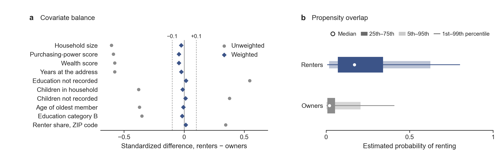

# Econometric methods

What each estimate in the [main README](../README.md) measures, what it assumes, and how it is computed. The numbers
quoted here are in the [result tables](../results/README.md).

## 1. The question

Charging at home needs somewhere to park and access to electricity there. The first is a feature of the building. The
second often means installing a charger or new wiring, which is an investment in the building: a tenant benefits while
living there, and the equipment stays with the home when the tenant moves.

This is the split-incentive problem known from energy use in rented housing
([Gillingham, Harding and Rapson 2012](https://doi.org/10.5547/01956574.33.2.3)): a tenant may move before a charger
pays off and may not be allowed to install one, and a landlord gains from installing it only if the rent rises. The
prediction is specific: among households whose homes have somewhere to park, renting should lower
ownership of the vehicle that needs the investment by more than it lowers ownership of other vehicles.

Three comparisons connect the housing decision to vehicle ownership.

1. **Parking.** Street-level images show similar rates of visible private parking at rented and owned single-family
   homes (section 2).
2. **The charger.** Charger installations are not recorded. The investment explanation is tested through the renter
   gap across vehicles: about the same for hybrids and plug-in hybrids, and largest for battery-electric vehicles
   (section 3).
3. **Split incentives.** The pattern across vehicles and the gap among condo owners (section 7) are consistent with
   split incentives. Installations and lease terms are not observed, so this link is the interpretation of the
   evidence, not a direct measurement.

## 2. Parking, measured from images

Street images record visible private off-street parking, one image per sampled home. Among single-family homes with
usable images, the weighted share without it is 6.5% for rentals and 5.6% for owner-occupied homes (difference 0.9
points, 95% CI −2.9 to 5.3). In other multi-unit buildings the shares are 79% and 42%, so a renter gap there would mix
parking with the charger. The comparison in section 3 is therefore restricted to single-family homes, where the
measured parking rates are similar.

Property records cannot do this job. Within a building type, their garage and parking fields predict the image's
answer with an AUC of 0.57 to 0.69.

Among single-family homes with visible private parking, the adjusted odds ratio for plug-in ownership is 0.39 for
renters relative to owners (95% CI 0.24–0.65). Across all building types, the adjusted odds ratio for homes without
visible private parking relative to homes with it is 0.82 (95% CI 0.64–1.03). The renter comparison in section 3 uses
the full household table ([image-sample comparisons](../results/2_parking/ownership_odds_image_sample.csv)).

## 3. What is estimated, and what it assumes

Let *D* = 1 if the household rents, *Y(d)* its plug-in ownership under tenure *d*, and *X* its observed
characteristics: wealth, purchasing power, age, household size, education, children, years at the address and an index
of technology use; the home's year built, size, lot and value; the ZIP code's size, wealth, building mix, renter share,
home values and vehicle mix; and the state. The main quantity is the effect on renters, on a ratio scale:

    ownership ratio = E[Y(1) | D = 1] / E[Y(0) | D = 1].

**Assumption 1 (comparable up to a common factor).** Given *X*, any remaining difference between renters and owners
moves ownership of plug-ins and of a vehicle that needs no charger in the same proportion.

This is weaker than assuming that renters and owners are fully comparable given *X*. It allows unobserved differences
in the taste for new or expensive vehicles, as long as they affect the comparison vehicle equally. What it identifies
is a ratio of ratios, called the net gap here:

    net gap = ownership ratio (plug-in) / ownership ratio (comparison vehicle) − 1.

It is a difference-in-differences across vehicles instead of across time, on a multiplicative scale. The comparison
vehicles act as negative-control outcomes ([Lipsitch, Tchetgen Tchetgen and Cohen 2010](https://doi.org/10.1097/EDE.0b013e3181d61eeb)): outcomes exposed to
the same sources of bias but not to the charging mechanism. Two comparison
vehicles are used because they capture different preferences: hybrids share the interest in saving fuel, and recent
luxury gasoline cars share the spending on new, expensive vehicles.

**Assumption 2 (overlap).** For every renter there are owners with similar *X*. Fields that exist only for owners
(home equity, loan-to-value, mortgage rate, sale year) are left out of *X*, because they would predict tenure
perfectly without being causes of vehicle choice.

**A check inside the plug-in category.** Plug-in hybrids and battery-electric vehicles share the plug, the incentives
and much of the buyer profile, and differ in how much they rely on charging: a plug-in hybrid can run on gasoline,
while a battery-electric vehicle cannot. If the net gap came from a taste for new or efficient vehicles, both should
fall together. Renters own 37% fewer plug-in hybrids than comparable owners, 3% below the hybrid gap and not
distinguishable from it (95% CI −10% to 4%), and 51% fewer battery-electric vehicles, 23% below the plug-in hybrid gap
(16% to 28%). The gap follows the reliance on charging.

**Where the assumptions could fail.**

- *Substitution.* If a renter who cannot charge buys a hybrid instead, the hybrid ratio rises and the net gap against
  hybrids is overstated. The luxury gasoline comparison is less exposed to this.
- *Unequal effects.* If the taste for new technology is stronger for plug-ins than for either comparison vehicle,
  part of the net gap still reflects who rents.
- *Tenure records.* Tenure is recorded for 80% of households. Counting the rest as renters is reported as a check
  (section 6).

## 4. Estimators

The probability of renting *e(X)* = P(D = 1 | X), the propensity score ([Rosenbaum and Rubin 1983](https://doi.org/10.1093/biomet/70.1.41)), and the outcome models *m_d(X)* = E[Y | D = d, X] and
*l(X)* = E[Y | X] are gradient-boosting models ([Friedman 2001](https://doi.org/10.1214/aos/1013203451)) fitted with five-fold cross-fitting.

- **Inverse-propensity weighting (IPW).** Owners are weighted by *e(X) / (1 − e(X))* so that they resemble renters
  ([Hirano, Imbens and Ridder 2003](https://doi.org/10.1111/1468-0262.00442)).
- **Augmented inverse-propensity weighting (AIPW)** ([Robins, Rotnitzky and Zhao 1994](https://doi.org/10.1080/01621459.1994.10476818)). For the effect on renters,

      E[Y(0) | D = 1] = E[ D m_0(X) + (1 − D) e(X)/(1 − e(X)) (Y − m_0(X)) ] / P(D = 1).

  Under overlap and Assumption 1, it is consistent if either the propensity model or the owner outcome model is
  correctly specified (doubly robust). Cross-fitting keeps the households used to fit these models apart from those
  they score. Valid intervals also need adequate overlap and reasonably accurate nuisance models.
- **Double machine learning (DML), partially linear model** ([Chernozhukov et al. 2018](https://doi.org/10.1111/ectj.12097)). The residual of *Y* on *l(X)* is regressed on the
  residual of *D* on *e(X)*. The coefficient is the adjusted difference in percentage points; the main AIPW result
  instead expresses renter ownership relative to comparable owners.
- **Intervals for the net gap.** The plug-in and comparison estimates come from the same households, so the standard
  error of the net gap uses their joint influence functions.
- **Exact matching.** Each renter is compared only with owners in the same ZIP code, wealth decile, age band,
  household size and years-at-the-address band; cells without both are dropped. It is the most transparent estimator
  and the least flexible: it cannot hold continuous variables such as home value fixed.
- **Poisson regression with ZIP code fixed effects** ([Santos Silva and Tenreyro 2006](https://doi.org/10.1162/rest.88.4.641)). A comparison inside the ZIP code, with wealth decile, age,
  education and household size. Its coefficients are log ratios, standard errors are clustered by ZIP code, and it is
  consistent for the conditional mean whatever the distribution of the outcome.

The estimators differ in what they hold fixed. The machine-learning estimators use a rich *X* and no ZIP code fixed
effects; matching and the Poisson regression compare inside the ZIP code with a coarser *X*. They agree on the size
of the net gap: 20% to 28% (AIPW), 29% to 32% (exact matching) and 29% to 31% (Poisson).

## 5. Balance and overlap

**Figure A1 | Weighting balances measured covariates, and the propensity distributions show where overlap is limited.** **a**, Standardized differences for the ten covariates with the largest absolute differences before weighting; across all covariates the largest after weighting is 0.04, and dashed lines mark ±0.1. **b**, Renter and owner propensity distributions: open points mark medians, dark bars the middle half, light bars the 5th–95th percentiles and lines the 1st–99th percentiles. Before clipping, 31% of owners and 2% of renters fall outside 0.01–0.99.

- **Balance.** The largest standardized difference between renters and owners is 0.60 before weighting and 0.04
  after; none of 43 covariates exceeds 0.1.
- **Overlap.** The propensity model separates the groups well (AUC 0.86). 31% of owners have an estimated probability
  of renting below 0.01; they get almost no weight in the effect on renters, which is why that quantity is preferred
  to the average effect. The weighted owners carry an effective sample of 212,693 households.
- **Comparison vehicles.** Renters also own fewer hybrids (ratio 0.65) and fewer recent luxury gasoline cars (0.72).
  These ratios are below one, which is why the plug-in ratio (0.52) is not read as the effect of charging by itself.

## 6. Sensitivity to unobserved differences

- **E-value** ([VanderWeele and Ding 2017](https://doi.org/10.7326/M16-2607)). For a ratio *RR* below one, the E-value is 1/RR + sqrt((1/RR) × (1/RR − 1)): the association, on the
  ratio scale, that an unobserved variable would need with both renting and plug-in ownership, beyond *X*, to bring
  the estimate to one. Applied to the net ratio, the variable would also have to leave the comparison vehicle
  untouched. It is 1.81 against hybrids and 2.13 against luxury gasoline cars (1.69 and 2.00 at the bound of the
  interval nearer one) ([sensitivity](../results/3_renter_gap/sensitivity.csv)).
- **Robustness value** ([Cinelli and Hazlett 2020](https://doi.org/10.1111/rssb.12348)). For the partially linear estimate of the effect on plug-ins, an unobserved variable would
  need to explain 2.5% of the residual variance of both renting and plug-in ownership to bring it to zero. This is
  small in absolute terms because ownership is rare, which is the reason the conclusions rest on the net gap and not
  on the plug-in estimate alone.
- **Omitting observed controls.** On a 3% sample of owners, leaving out the controls for wealth and home value, for
  the ZIP code and state, or for years at the address leaves the net gap between 19% and 28%. The observed controls
  that matter most for tenure move the estimate by a few points, a benchmark for how much an unobserved one of similar
  strength could move it.
- **Tenure not recorded.** Counting the 1.6 million single-family households with no recorded tenure as renters gives
  17% to 21%.

## 7. Other explanations

**Sorting.** A household that wants a plug-in may buy a house in order to charge. This would produce a renter gap in
plug-ins and not in other vehicles, as split incentives do. Households at the address for 15 years or more chose the
home before plug-ins were on general sale. Among them the net gap of renters of single-family homes is 9% to 10%
(AIPW) and 17% to 19% (Poisson), against 20% to 28% and 29% to 31% for all renters. The smaller gap has two readings
that these data cannot separate: part of the full-sample gap is sorting, or tenants with a long horizon are less
constrained because an installation pays back over more years. The estimates for long-standing residents are the
ones least exposed to sorting, and they remain below zero.

**Owners without control of the building.** Condo owners are owners, so differences between renters and owners in
credit, wealth or stage of life do not apply to them. Inside the same ZIP code they own 8% more hybrids and 8% more
luxury gasoline cars than owners of single-family homes and 17% fewer plug-ins, a net gap of 23%; among condo owners
at the address 15 years or more it is 27% to 30%. Half of condos have no private off-street parking, so this
comparison mixes the physical condition with control over the building, which the single-family comparison does not.

**One car.** A household with one vehicle may not want it to be electric, and renters own fewer vehicles. Among
households with two or more vehicles, exact matching gives a net gap of 26% against hybrids and 30% against luxury
gasoline cars, and battery-electric vehicles 28% below plug-in hybrids. The number of vehicles is itself a choice, so
this is a check on one explanation, not a preferred specification.

## 8. Differences across renters

Group effects are weighted means of the doubly robust scores within groups defined in advance, so each is itself
doubly robust. A causal forest ([Wager and Athey 2018](https://doi.org/10.1080/01621459.2017.1319839); [Athey, Tibshirani and Wager 2019](https://doi.org/10.1214/18-AOS1709)),
implemented as [CausalForestDML](https://github.com/py-why/EconML), is fitted on 250,000 households and evaluated on 600,000 others:
households are sorted into fifths by the forest's prediction, and the doubly robust scores give the effect in each
fifth, so the forest is judged on households it never saw. Its predictions line up with the estimates in percentage
points (2.92 against 2.65 in the top fifth; 0.16 against 0.20 in the bottom fifth). They track the baseline rate of
ownership: in ratio terms the fifths do not differ systematically.

## 9. Estimating a share from model labels and an audit

The share of homes without visible private parking is estimated from labels produced by a vision model. Model labels
alone are biased if the model errs more for some homes. Prediction-powered inference ([Angelopoulos et al. 2023](https://doi.org/10.1126/science.adi6000)) combines the model's labels with
hand labels on a randomly selected audit: the estimate is the weighted mean of the model's labels plus the weighted
mean of the audit's correction (hand label minus model label). Because the audit is a random draw, the correction
removes the model's average error without assuming the model is right, and the estimate is more precise than the
audit alone when the model is accurate. The estimates describe homes with a street-level image that could be judged
([population shares](../results/2_parking/parking_shares.csv),
[tenure comparison](../results/2_parking/parking_by_tenure.csv)).

The image sample over-represents plug-in households, so shares use inverse inclusion probabilities. For regressions
with plug-in ownership as the outcome, sampling depends on the outcome within strata; a logit with the log ratio of
the two sampling rates as an offset recovers population odds ratios without weights.

## 10. The gap in units of price

With a constant price elasticity of demand *e*, a price higher by a share *t* changes quantity by the factor
(1 + t)^e. A net gap *g* is therefore the same size as a price increase of

    t = (1 + g)^(1/e) − 1.

| Published elasticity for electric vehicles | Net gap 20% (against hybrids) | Net gap 28% (against luxury gasoline) |
|---|---|---|
| −2.76, [Xing, Leard and Li (2021)](https://doi.org/10.1016/j.jeem.2021.102432) | 8.5% higher price | 12.8% |
| −2.1, [Muehlegger and Rapson (2022)](https://doi.org/10.1016/j.jpubeco.2022.104752) | 11.3% higher price | 17.1% |

For renters of single-family homes, plug-in ownership is as low as if the vehicle cost 9% to 17% more. At the median
price of a plug-in owned in the 15 states ($48,490), that is $4,100 to $8,300 per vehicle. This is a change of units,
and it carries the assumptions of section 3. The elasticities come from other samples (US new-vehicle buyers; low- and
middle-income households in California), and an elasticity of new purchases is applied to a difference in the stock of
vehicles owned.

## 11. Prediction in other states

The ownership model is scored on whole states that were held out, which is the relevant test for a model moved to a
new market. The ranking of households transfers (AUC 0.72 to 0.81) and the totals do not: predicted counts range from
0.73 to 2.93 times observed counts, because the rate of ownership differs across states by a factor of ten. Local
totals therefore need calibration to a benchmark, as with the state totals in section 1 of the README
([held-out state results](../results/5_which_renters/auc_by_held_out_state.csv)).

## 12. Policy simulation

All calculations start from the doubly robust estimates for renters of single-family homes and add no new estimation.

**1. The ownership shortfall.** With N renter households, an observed plug-in rate a and the rate b of comparable
owners, the shortfall is N (b − a): 878,879 × (1.754% − 0.910%) ≈ 7,400 households.

**2. Removing the barrier.** Let r be the net ratio: the renter-to-owner plug-in ownership ratio divided by the same
ratio for the comparison vehicle. If renting affected plug-ins only as much as it affects the comparison vehicle,
N a / r renter households would own a plug-in. The increase is N a (1/r − 1) households: 2,011 against hybrids
(r = 0.799) and 3,151 against luxury gasoline cars (r = 0.717).

**3. An equivalent purchase rebate.** Treat the barrier as an implicit cost: renters behave as if the vehicle's price
were p(1 + t), with (1 + t)^e = r for a constant price elasticity e, so t = r^(1/e) − 1 (section 10): 8.5% to 17.1%
for e = −2.76 and −2.1. A rebate of t p returns the effective price to p. At the median price of plug-in vehicles
owned in the 15 states ($48,490) it is $4,105 to $8,309 per vehicle, 55% to 111% of the former $7,500 federal credit.

**4. Where the shortfall is.** For each of 300,000 renters held out from the causal forest's training, the shortfall
is m0(X) − Y, where m0 is the cross-fitted outcome model for owners. Renters are ranked by the ownership model and,
separately, by the forest's predicted loss from renting. The top 20% hold 60.1% (95% CI 58.2–61.9) and 59.9%
(57.9–61.8) of the summed shortfall, against 20% for a random fifth.

**5. Cost of a purchase rebate per additional plug-in household.** Let A be the plug-in households observed among
renters. A rebate s that offsets the ratio r raises them to A / r, so it adds A (1/r − 1) households and costs s A / r,
since every buyer receives it. The cost per additional household is s / (1 − r): $20,431 and $27,203 against hybrids
(e = −2.76 and −2.1), $21,941 and $29,400 against luxury gasoline cars. Most recipients would have bought anyway, which
is why the cost per additional household is several times the rebate itself.

**6. Installation support.** Let C be the cost of an installation and q the share of the barrier that paying for it
removes (q = 1 if cost is the whole barrier, less if consent, approval or a short lease also matter). Plug-in
households rise from A to A + q A (1/r − 1). If only the new plug-in households claim the payment, the cost per
additional household is C. If every renter with a plug-in claims it, the cost is C (1 + r / (q (1 − r))), which is
C / (1 − r) at q = 1.

C comes from public electrical permits. In Cambridge, MA, 131 permits for one charger at a one- or two-family home or
townhouse with no other work named have a median declared value of $1,500 (quartiles $1,084 and $2,500); 39 that also
name panel or service work have a median of $4,350. In Dallas, TX, 39 single-family charger permits with a plausible
value have a median of $645; 69% of that city's records carry a value under $100 and are left out, so Dallas is a
cross-check only.

**7. The barrier and the cost of the work.** The rebate that offsets the barrier ($4,100 to $8,300 per eligible
vehicle) is several times the $1,500 median declared value of a Cambridge charger-only permit. The two come from
different sources: one is inferred from ownership and demand elasticities, the other describes completed electrical
work. A renter may also need the landlord's permission or expect to move, and a payment for the work changes neither.
This is why q is varied in the simulation and not fixed at one.

**8. Household-level simulation.** The formulas above use totals and a single installation cost. The simulation
repeats them household by household. Each of the 878,879 renter households has a probability of owning a plug-in,
from the cross-fitted ownership model scaled to the observed total. In each of 500 draws, the net ratio r is drawn
around its estimate, the comparison vehicle is chosen at random, the elasticity is drawn uniformly between −2.76 and
−2.1, and each household receives one random number that is used for every policy, so that the policies are compared
on the same households. For installation support, each household that would own a plug-in only without the barrier
gains one with probability q, and each claim costs a draw from the permit values (a charger alone, or with
probability 0.23 one with panel or service work).

| Policy | Plug-in households added | Spending | Cost per additional household (95% range) |
|---|---|---|---|
| Purchase rebate | 2,595 | $64.0M | $24,440 (20,497–29,158) |
| Installation support, only new plug-in households claim, full barrier removed | 2,595 | $7.1M | $2,728 (2,617–2,831) |
| Installation support, all plug-in renters claim, full barrier removed | 2,595 | $28.9M | $11,638 (8,833–15,607) |
| Installation support, all plug-in renters claim, half the barrier removed | 1,297 | $25.3M | $20,565 (14,908–28,692) |
| Installation support, all plug-in renters claim, a quarter removed | 648 | $23.5M | $38,422 (26,985–55,994) |

The simulation reproduces the formulas (2,595 households added and $24,440 per additional household, against 2,595 and
$24,444; 76% of rebate recipients would own a plug-in anyway). When all plug-in renters claim, installation support
costs less than the purchase rebate in 100% of draws if it removes the full barrier, 71% if half and 3% if a quarter.
The mean cost of a claim is about $2,730, above the $1,500 median, because 23% of claims include panel or service
work ([policy costs](../results/4_policy/policy_costs.csv), [simulation checks](../results/4_policy/simulation_checks.csv)).

**How to read these calculations.** They are a first, intuitive pass that expresses the estimates above in households
and dollars and compares the two policies. A structural model of vehicle choice and charger installation, with formal
policy counterfactuals, is being developed in a companion paper, and this repository will be updated with it. A few
points apply in the meantime. Both policies use public money: installation support costs C per claim, and a right to
install without a payment leaves that cost with the tenant and adds administration. A right to install would not
remove the barrier for every renter. A purchase rebate would also reach owners and may be partly passed through to
prices. Permit values describe installations that were carried out, which may have cost less than those that were
not. The share of the shortfall in the top fifth shows where the shortfall is, not how much of it a program would
close.

## References

Every study and method cited in this repository, with a link to the original publication.

**Economics of electric vehicles and rented housing**

- Davis, L. W. (2019). [Evidence of a homeowner-renter gap for electric vehicles.](https://doi.org/10.1080/13504851.2018.1523611) *Applied Economics Letters* 26(11), 927–932.
- Gillingham, K., Harding, M. and Rapson, D. (2012). [Split incentives in residential energy consumption.](https://doi.org/10.5547/01956574.33.2.3) *The Energy Journal* 33(2), 37–62.
- Muehlegger, E. and Rapson, D. S. (2022). [Subsidizing low- and middle-income adoption of electric vehicles: Quasi-experimental evidence from California.](https://doi.org/10.1016/j.jpubeco.2022.104752) *Journal of Public Economics* 216, 104752.
- Xing, J., Leard, B. and Li, S. (2021). [What does an electric vehicle replace?](https://doi.org/10.1016/j.jeem.2021.102432) *Journal of Environmental Economics and Management* 107, 102432.

**Causal inference and sensitivity analysis**

- Athey, S., Tibshirani, J. and Wager, S. (2019). [Generalized random forests.](https://doi.org/10.1214/18-AOS1709) *Annals of Statistics* 47(2), 1148–1178.
- Chernozhukov, V., Chetverikov, D., Demirer, M., Duflo, E., Hansen, C., Newey, W. and Robins, J. (2018). [Double/debiased machine learning for treatment and structural parameters.](https://doi.org/10.1111/ectj.12097) *The Econometrics Journal* 21(1), C1–C68.
- Cinelli, C. and Hazlett, C. (2020). [Making sense of sensitivity: Extending omitted variable bias.](https://doi.org/10.1111/rssb.12348) *Journal of the Royal Statistical Society: Series B* 82(1), 39–67.
- Hirano, K., Imbens, G. W. and Ridder, G. (2003). [Efficient estimation of average treatment effects using the estimated propensity score.](https://doi.org/10.1111/1468-0262.00442) *Econometrica* 71(4), 1161–1189.
- Lipsitch, M., Tchetgen Tchetgen, E. and Cohen, T. (2010). [Negative controls: A tool for detecting confounding and bias in observational studies.](https://doi.org/10.1097/EDE.0b013e3181d61eeb) *Epidemiology* 21(3), 383–388.
- Robins, J. M., Rotnitzky, A. and Zhao, L. P. (1994). [Estimation of regression coefficients when some regressors are not always observed.](https://doi.org/10.1080/01621459.1994.10476818) *Journal of the American Statistical Association* 89(427), 846–866.
- Rosenbaum, P. R. and Rubin, D. B. (1983). [The central role of the propensity score in observational studies for causal effects.](https://doi.org/10.1093/biomet/70.1.41) *Biometrika* 70(1), 41–55.
- Santos Silva, J. M. C. and Tenreyro, S. (2006). [The log of gravity.](https://doi.org/10.1162/rest.88.4.641) *Review of Economics and Statistics* 88(4), 641–658.
- VanderWeele, T. J. and Ding, P. (2017). [Sensitivity analysis in observational research: Introducing the E-value.](https://doi.org/10.7326/M16-2607) *Annals of Internal Medicine* 167(4), 268–274.
- Wager, S. and Athey, S. (2018). [Estimation and inference of heterogeneous treatment effects using random forests.](https://doi.org/10.1080/01621459.2017.1319839) *Journal of the American Statistical Association* 113(523), 1228–1242.

**Measurement and machine learning**

- Angelopoulos, A. N., Bates, S., Fannjiang, C., Jordan, M. I. and Zrnic, T. (2023). [Prediction-powered inference.](https://doi.org/10.1126/science.adi6000) *Science* 382(6671), 669–674.
- Cho, K., van Merriënboer, B., Gulcehre, C., Bahdanau, D., Bougares, F., Schwenk, H. and Bengio, Y. (2014). [Learning phrase representations using RNN encoder–decoder for statistical machine translation.](https://doi.org/10.3115/v1/D14-1179) *Proceedings of EMNLP 2014*, 1724–1734.
- Cohen, J. (1960). [A coefficient of agreement for nominal scales.](https://doi.org/10.1177/001316446002000104) *Educational and Psychological Measurement* 20(1), 37–46.
- Friedman, J. H. (2001). [Greedy function approximation: A gradient boosting machine.](https://doi.org/10.1214/aos/1013203451) *Annals of Statistics* 29(5), 1189–1232.
- Hinton, G., Vinyals, O. and Dean, J. (2015). [Distilling the knowledge in a neural network.](https://arxiv.org/abs/1503.02531) arXiv:1503.02531.
- Liu, Z., Mao, H., Wu, C.-Y., Feichtenhofer, C., Darrell, T. and Xie, S. (2022). [A ConvNet for the 2020s.](https://doi.org/10.1109/CVPR52688.2022.01167) *Proceedings of CVPR 2022*, 11966–11976.
- Vaswani, A., Shazeer, N., Parmar, N., Uszkoreit, J., Jones, L., Gomez, A. N., Kaiser, Ł. and Polosukhin, I. (2017). [Attention is all you need.](https://proceedings.neurips.cc/paper/2017/hash/3f5ee243547dee91fbd053c1c4a845aa-Abstract.html) *Advances in Neural Information Processing Systems* 30.

Software: [EconML](https://github.com/py-why/EconML) (CausalForestDML).
